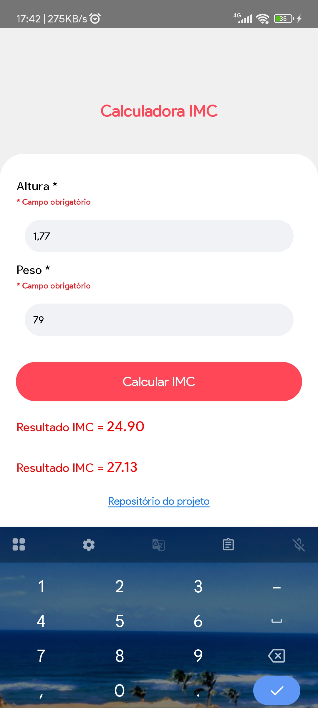
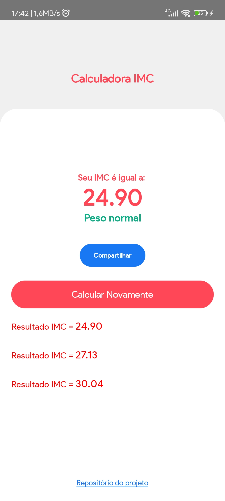

# Calculadora de IMC

Aplicativo Android para cálculo do Índice de Massa Corporal (IMC), desenvolvido em **Kotlin** utilizando **Jetpack Compose**.

O projeto tem como objetivo praticar o desenvolvimento de interfaces Android declarativas e a implementação de funcionalidades básicas de uma aplicação mobile.

## Funcionalidades

- **Cálculo do IMC:** utiliza os valores de peso e altura informados pelo usuário.
- **Classificação do resultado:** apresenta a classificação correspondente ao IMC calculado, considerando as faixas de referência para adultos.
- **Validação de campos:** verifica o preenchimento dos dados necessários para o cálculo.
- **Histórico de resultados:** mantém os resultados calculados durante a utilização do aplicativo.
- **Compartilhamento:** permite compartilhar o resultado por meio dos aplicativos disponíveis no dispositivo.


## Tecnologias utilizadas

| Tecnologia | Finalidade |
| --- | --- |
| Kotlin | Linguagem de programação |
| Jetpack Compose | Construção da interface |
| Material 3 | Componentes visuais |
| Android SDK | Plataforma de desenvolvimento |
| Gradle | Automação de build e gerenciamento de dependências |


## Fórmula do IMC

O cálculo é realizado utilizando a seguinte fórmula:

<div align="center">
  <div style="display: inline-flex; align-items: center; gap: 12px; font-size: 24px;">
    <strong>IMC =</strong>
    <div style="display: inline-flex; flex-direction: column; align-items: center;">
      <div style="padding: 4px 16px; border-bottom: 2px solid;">
        Peso (kg)
      </div>
      <div style="padding: 4px 16px;">
        Altura (m)<sup>2</sup>
      </div>
    </div>
  </div>
</div>

Onde:
- **Peso:** informado em quilogramas (kg).
- **Altura:** informada em metros (m).

### Classificação do IMC

As faixas utilizadas pelo aplicativo são referências para adultos:

| IMC | Classificação |
| --- | --- |
| Abaixo de 18,5 | Abaixo do peso |
| 18,5 a 24,9 | Peso normal |
| 25,0 a 29,9 | Sobrepeso |
| 30,0 a 34,9 | Obesidade grau I |
| 35,0 a 39,9 | Obesidade grau II |
| 40,0 ou mais | Obesidade grau III |

## Pré-requisitos

Para executar o projeto, é necessário:

- Android Studio.
- JDK compatível com a versão do Android Gradle Plugin utilizada.
- Android SDK com API 37.
- Emulador Android ou dispositivo físico com Android 7.0 (API 24) ou superior.

## Como executar

1. Clone o repositório:

   ```bash
   git clone https://github.com/emanuelsousa08/calculadora-imc-kotlin.git
   ```

2. Acesse o diretório:

   ```bash
   cd calculadora-imc-kotlin
   ```

3. Abra o projeto no Android Studio.

4. Aguarde a sincronização do Gradle e o download das dependências.

5. Selecione um emulador ou conecte um dispositivo Android compatível.

6. Execute o aplicativo pela opção **Run** do Android Studio.

### Gerar APK de depuração

Também é possível gerar o APK utilizando o Gradle Wrapper:

**Windows:**

```bash
gradlew.bat assembleDebug
```

**Linux/macOS:**

```bash
./gradlew assembleDebug
```

O arquivo gerado estará disponível em:

```text
app/build/outputs/apk/debug/app-debug.apk
```

## Estrutura do projeto

```text
calculadora-imc-kotlin/
├── app/
├── docs/
│   └── images/
│       ├── tela-inicial.jpg
│       ├── campos-obrigatorios.jpg
│       ├── preenchimento-campos.jpg
│       └── resultados-e-historico.jpg
├── gradle/
├── README.md
├── build.gradle.kts
├── settings.gradle.kts
├── gradlew
└── gradlew.bat
```

## Capturas de tela

As imagens abaixo demonstram algumas das principais funcionalidades e etapas de utilização do aplicativo.

<p align="center">
  
  
  
  
</p>

## Observações

O IMC é um indicador de referência e não substitui uma avaliação individual realizada por um profissional de saúde. As classificações apresentadas são destinadas à interpretação geral de adultos.

## Licença

Este projeto está licenciado sob os termos da licença [MIT](LICENSE).

Consulte o arquivo `LICENSE` para obter mais informações.

## Autor

**Emanuel Sousa**

- GitHub: [@emanuelsousa08](https://github.com/emanuelsousa08)
- Repositório: [calculadora-imc-kotlin](https://github.com/emanuelsousa08/calculadora-imc-kotlin)