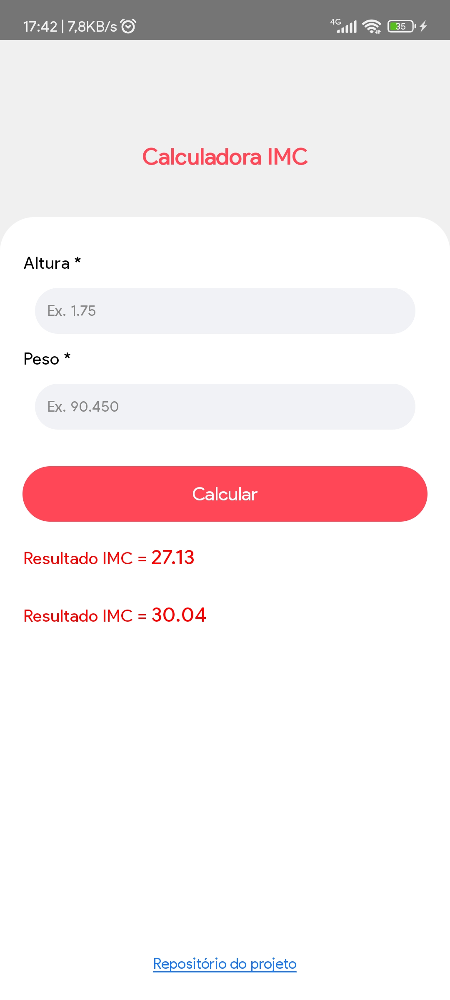
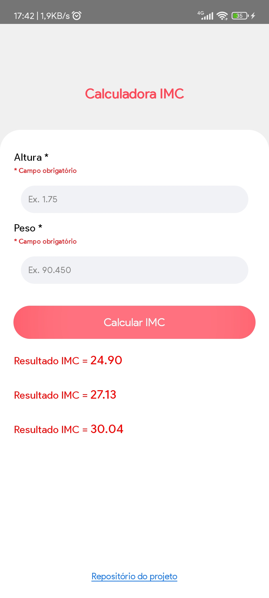

# Calculadora de IMC

[](https://github.com/emanuelsousa08/calculadora-imc-kotlin/actions/workflows/android-ci.yml)

[](LICENSE)


Aplicativo Android para cálculo do Índice de Massa Corporal (IMC), desenvolvido em **Kotlin** utilizando **Jetpack Compose**.

Este projeto é a versão em Kotlin de um aplicativo que desenvolvi originalmente em React Native: [calculadora-imc](https://github.com/emanuelsousa08/calculadora-imc).

O projeto tem como objetivo praticar o desenvolvimento de interfaces Android declarativas e a implementação de funcionalidades básicas de uma aplicação mobile.

## Funcionalidades

- **Cálculo do IMC:** utiliza os valores de peso e altura informados pelo usuário.
- **Classificação do resultado:** apresenta a classificação correspondente ao IMC calculado, considerando as faixas de referência para adultos.
- **Validação de campos:** verifica o preenchimento dos dados necessários para o cálculo.
- **Histórico de resultados:** mantém os resultados calculados durante a utilização do aplicativo.
- **Compartilhamento:** permite compartilhar o resultado por meio dos aplicativos disponíveis no dispositivo.
- **Link para o repositório:** botão que abre a página do projeto no GitHub.


## Tecnologias utilizadas

| Tecnologia | Finalidade |
| --- | --- |
| Kotlin | Linguagem de programação |
| Jetpack Compose | Construção da interface |
| Material 3 | Componentes visuais |
| Android SDK | Plataforma de desenvolvimento |
| Gradle | Automação de build e gerenciamento de dependências |


## Fórmula do IMC

O cálculo é realizado utilizando a seguinte fórmula:

<p align="center">
  
</p>

Onde:
- **Peso:** informado em quilogramas (kg).
- **Altura:** informada em metros (m).


### Classificação do IMC

As faixas utilizadas pelo aplicativo são referências para adultos:

| IMC | Classificação |
| --- | --- |
| Abaixo de 18,5 | Abaixo do peso |
| De 18,5 a menos de 25,0 | Peso normal |
| De 25,0 a menos de 30,0 | Sobrepeso |
| De 30,0 a menos de 35,0 | Obesidade grau I |
| De 35,0 a menos de 40,0 | Obesidade grau II |
| 40,0 ou mais | Obesidade grau III |

## Pré-requisitos

Para executar o projeto, é necessário:

- Android Studio.
- JDK compatível com a versão do Android Gradle Plugin utilizada.
- Android SDK com API 37.
- Emulador Android ou dispositivo físico com Android 7.0 (API 24) ou superior.

## Como executar

1. Clone o repositório:

   ```bash
   git clone https://github.com/emanuelsousa08/calculadora-imc-kotlin.git
   ```

2. Acesse o diretório:

   ```bash
   cd calculadora-imc-kotlin
   ```

3. Abra o projeto no Android Studio.

4. Aguarde a sincronização do Gradle e o download das dependências.

5. Selecione um emulador ou conecte um dispositivo Android físico (veja [Executando em um dispositivo físico](#executando-em-um-dispositivo-físico)).

6. Execute o aplicativo pela opção **Run** do Android Studio.


### Executando em um dispositivo físico

Se você não for usar o emulador do Android Studio, pode rodar o aplicativo direto no seu celular (Android 7.0 / API 24 ou superior). Para isso, é preciso ativar a depuração USB:

1. **Ative as opções do desenvolvedor:** em **Configurações → Sobre o telefone**, toque 7 vezes em **Número da versão** (em alguns aparelhos o nome varia, como "Versão do MIUI" em celulares Xiaomi).
2. **Ative a depuração USB:** em **Configurações → Sistema → Opções do desenvolvedor**, ligue a opção **Depuração USB**. O caminho exato pode mudar conforme o fabricante.
3. **Conecte o celular ao computador** com um cabo USB que transmita dados, em modo **Transferência de arquivos**.
4. **Autorize o computador:** aceite o aviso "Permitir depuração USB?" que aparece na tela do celular.
5. No Android Studio, escolha o aparelho na lista de dispositivos, no topo da janela, e clique em **Run**.

Para conferir se o aparelho foi reconhecido, use o comando abaixo (o `adb` fica na pasta `platform-tools` do Android SDK). O aparelho deve aparecer como `device`; se aparecer como `unauthorized`, aceite o aviso no celular.

```bash
adb devices
```


### Gerar APK de depuração

Também é possível gerar o APK utilizando o Gradle Wrapper:

**Windows:**

```bash
gradlew.bat assembleDebug
```

**Linux/macOS:**

```bash
./gradlew assembleDebug
```

O arquivo gerado estará disponível em:

```text
app/build/outputs/apk/debug/app-debug.apk
```

Para instalar o APK manualmente, copie o arquivo para o celular (cabo, Google Drive, e-mail etc.), abra-o pelo gerenciador de arquivos e permita a instalação de fontes desconhecidas quando o sistema pedir.

## Testes

Para executar os testes unitários da classificação do IMC:

```bash
./gradlew test
```

## Estrutura do projeto

```text
calculadora-imc-kotlin/
├── app/
├── docs/
│   └── images/
│       ├── formula-imc.svg
│       ├── tela-inicial.jpg
│       ├── campos-obrigatorios.jpg
│       ├── preenchimento-campos.jpg
│       └── resultados-e-historico.jpg
├── gradle/
├── LICENSE
├── README.md
├── build.gradle.kts
├── settings.gradle.kts
├── gradlew
└── gradlew.bat
```

## Capturas de tela

As imagens abaixo demonstram algumas das principais funcionalidades e etapas de utilização do aplicativo.

<p align="center">
  
  
  
  
</p>

## Observações

O IMC é um indicador de referência e não substitui uma avaliação individual realizada por um profissional de saúde. As classificações apresentadas são destinadas à interpretação geral de adultos.

## Licença

Este projeto está licenciado sob os termos da licença [MIT](LICENSE).

Consulte o arquivo `LICENSE` para obter mais informações.

## Autor

**Emanuel Sousa**

- GitHub: [@emanuelsousa08](https://github.com/emanuelsousa08)
- Repositório: [calculadora-imc-kotlin](https://github.com/emanuelsousa08/calculadora-imc-kotlin)